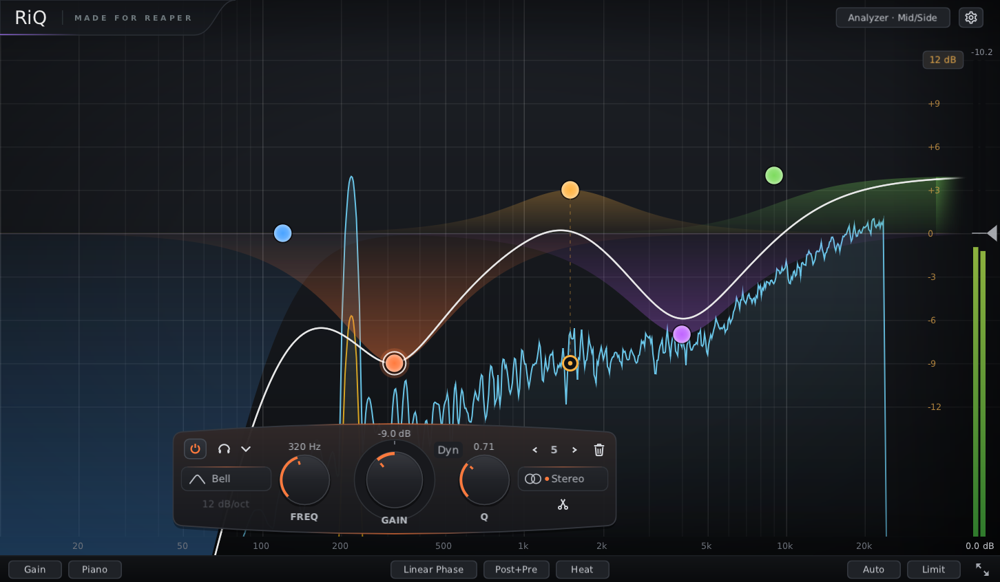

# RiQ

**RiQ** is a free parametric equalizer plugin in VST3 format for Windows,
Linux and macOS. It is a C++ port of the **ReEQ2 2.0.2** JSFX by Justin Johnson for
REAPER: the same filter math, dynamics and auto gain, with a native
interface in the style of modern equalizers. It is built on
[Capibara](https://github.com/Yagafgaf/Capibara), a small VST3 plugin
framework by the same author.

## Download

Get the latest build from the [Releases](https://github.com/Yagafgaf/RiQ-EQ/releases) page.

| System | File | Install to |
|---|---|---|
| Windows 10/11, x64 | `RiQ-<version>-Windows-x64-VST3.zip` | `C:\Program Files\Common Files\VST3\` |
| Linux, x64 (glibc 2.35+, e.g. Ubuntu 22.04 or newer) | `RiQ-<version>-Linux-x64-VST3.zip` | `~/.vst3/` |
| macOS 11+, Apple Silicon (arm64) | `RiQ-<version>-macOS-arm64-VST3.zip` | `~/Library/Audio/Plug-Ins/VST3/` |

Unzip the archive and copy the `RiQ.vst3` folder to the path above, then
rescan plugins in your host. The macOS build is for Apple Silicon (arm64),
runs on macOS 11 or newer and is ad-hoc signed; Intel Macs are not covered
by this build. If the downloaded bundle is quarantined, clear the attribute
with `xattr -dr com.apple.quarantine ~/Library/Audio/Plug-Ins/VST3/RiQ.vst3`.

RiQ is developed and tested in REAPER (native Linux, and the Windows build
through yabridge). It should work in any VST3 host, but other hosts are
not tested yet. Projects saved with earlier RiQ releases load unchanged and
sound the same. One exception: since 0.842 Output Gain spans -30..+12 dB
instead of +-12 dB, so Output Gain automation recorded with an earlier
release plays back at other values (the saved Output Gain itself loads
as it was).

## Features

- **16 bands, 14 filter types:** Bell, Low/High Shelf, Tilt Shelf, Low/High
  Cut (also Butterworth), Notch, Band Pass, All Pass, Pultec Low, Vintage
  Low/High. Cuts from 6 to 120 dB/oct. The filters are decramped
  (Ivantsov), so they keep their analogue shape near Nyquist.
- **Dynamic EQ** on every band: threshold, ratio, range, attack, release,
  soft knee, auto timing. The detector can be linked to the band or tuned
  separately, and can listen to the band itself or to one of three
  sidechain inputs.
- **Stereo placement** per band: Stereo, Mid, Side, Left, Right; one click
  splits a band into a Mid/Side pair.
- **Linear phase mode** with five resolutions (latency compensated by the
  host), plus optional lookahead.
- **Auto gain** with K-weighting; a right click on Auto moves the make-up
  into the output gain.
- **Listen:** solo a band, its detector, or sweep freely with
  `Ctrl`/`Alt` + drag on the graph.
- **Spectrum analyzer:** pre/post, Mid/Side or Left/Right, line, fill or
  heat display, tilt, peak hold, 1/48 to 1/6 octave smoothing, sidechain
  "ghost" spectrum for dynamic bands.
- **Interface:** resizable window, 100 to 250 % scale, compact modes, piano
  strip (C0 to C8), dB range 3/6/12/30 dB, multi-selection, precise value
  entry, colour themes, GPU (OpenGL) or software rendering. "Save as
  default" in the gear menu keeps the window and the analyzer and display
  settings for new instances.
- **REAPER embedded view:** the graph in miniature inside REAPER's track
  panel and mixer (TCP/MCP), with the same curves, band nodes and analyzer;
  drag a node, turn the wheel and double click to add a band there.
- Input gain, output gain from -30 to +12 dB, polarity, Mid/Side or Left/Right input gains, output
  meters, host bypass with latency kept, mono and stereo layouts,
  64-bit processing.

## Controls

- **Node:** drag to change frequency and gain, mouse wheel for Q in 0.1
  steps (the slope on Low/High Cut), double click to bypass, `Alt` + click
  to delete.
- **Piano strip:** the key under the pointer lights up with its name; drag
  a band's dot along the keys to move the band from note to note.
- **Empty space:** double click to add a band; drag a box or `Shift` + click
  to select several nodes and move them together.
- **Right click on a node:** shape, slope, stereo placement, dynamics,
  invert/zero gain, split, duplicate, delete (for all selected bands).
- **Band panel** appears when you hover a node: shape, slope, FREQ / GAIN /
  Q, stereo placement, band pager; the gear menu has Dynamic, Listen,
  Duplicate, Copy/Paste and Reset. Click a value above a knob to type it in.
- **`Ctrl`/`Alt` + drag** on the graph: free listen; the wheel changes its
  width.
- **Embedded view (REAPER):** drag a node for frequency and gain, the wheel
  for Q, double click empty space to add a band (Low Cut below 200 Hz, High
  Cut above 7 kHz, Bell between); right click a node for the band menu
  (Windows and Linux; the menu is not there on macOS yet). Clicks off the
  nodes go to REAPER; the left button does not open the plugin window.
- Click the RiQ logo for version and credits.

## Performance

RiQ is light on the CPU. In the same REAPER session it uses less CPU than
FabFilter Pro-Q 4 in every tested scenario (2 to 11 times less), and less
than ReaEQ in every scenario with more than one band. Full tables are in
[docs/riq-performance-tables.html](docs/riq-performance-tables.html)
(download the file and open it in a browser).

## License

RiQ is made by **Egor Gudkov** and distributed as binaries under the
[MIT License](LICENSE).

RiQ includes or derives from:

- **ReEQ2 2.0.2** by Justin Johnson (MIT): filters, dynamics, parameters
  and analyzer behaviour. https://github.com/Justin-Johnson/ReJJ
- **ivantsov-filters** by Yuriy Ivantsov (MIT): decramped filter math.
  https://github.com/yIvantsov/ivantsov-filters
- **PFFFT** by Julien Pommier (FFTPACK licence, BSD-like): FFT for linear
  phase and the analyzer.
- **Capibara** by Egor Gudkov (MIT), with the parts it ships: the
  **VST 3 SDK** by Steinberg (MIT), **NanoVG** by Mikko Mononen (zlib),
  **stb** by Sean Barrett (MIT / public domain) and the **Bitstream Vera**
  fonts (Bitstream Vera Fonts licence).
- **REAPER SDK** by Cockos Incorporated (zlib): the headers for the
  embedded view; no REAPER code is linked at run time.

Full copyright notices and licence texts are in
[THIRD_PARTY_NOTICES.md](THIRD_PARTY_NOTICES.md). Each release ships
`LICENSE` and `THIRD_PARTY_NOTICES.md` inside `RiQ.vst3/Contents/Resources/`.

VST is a registered trademark of Steinberg Media Technologies GmbH. RiQ is
not affiliated with FabFilter or Cockos.
